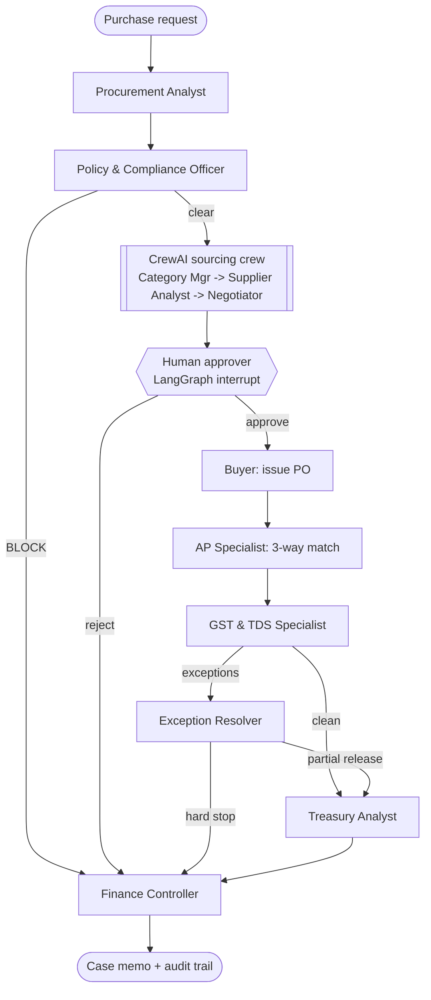

# AgentProcure: domain-expert AI agents for Procure-to-Pay

An MBA project that automates the **Procure-to-Pay (P2P)** process of a mid-size Indian manufacturer
(Meridian Precision Components Pvt. Ltd., a fictional auto-components company in Pune) with a team of
specialist AI agents. Each agent behaves like a real role in a P2P organisation and uses tested
domain rules for Indian compliance: GST, e-invoicing, TDS under the Income-tax Act 2025, the MSMED
Act 45-day rule and the procurement policy.

It uses six tools, each where it fits best:

| Tool | Role in the project |
|---|---|
| **LangGraph** | Runs the end-to-end P2P case as a stateful graph: routing, exception branches, a human approval step (`interrupt`) and a full audit trail. |
| **CrewAI** | A three-agent sourcing "crew" (Category Manager, Supplier Performance & Risk Analyst, Negotiation Strategist) running inside one LangGraph node. |
| **n8n** | Business automation around the agents: purchase-request intake, approval e-mails with approve/reject links, audit logging to Google Sheets, and a daily MSME payment watch. |
| **LangChain** | The model layer: `init_chat_model` switches between Gemini, OpenAI, Anthropic and Ollama; `with_structured_output` extracts requisitions; an LCEL chain (prompt, model, parser) drives the Policy Advisor; the knowledge base uses LangChain's text splitter, retriever and vector-store interfaces. |
| **RAG** | A policy and regulation knowledge base (39 clauses) searched with BM25, optionally fused with Gemini embeddings. The Policy Advisor answers questions with clause citations, the Procurement Analyst retrieves reminders for risky requests, and every finding names the clause behind it. |
| **Docker** | `docker compose up` starts the agents' API and n8n together, with both workflows imported and pointed at the API. |

**Runs with no API key.** In offline mode the CrewAI crew and every agent still run; the
reasoning text comes from expert templates. Add a free Gemini key (or OpenAI, Anthropic, Ollama)
and the same agents write their explanations with an LLM, checked by a guardrail.

---

## The agent team

| # | Agent | Framework | What it decides | Key tools (deterministic) |
|---|---|---|---|---|
| 1 | Procurement Analyst | LangGraph node | Turns a free-text request into a requisition | request parser / LLM extraction, budget check |
| 2 | Policy & Compliance Officer | LangGraph node | Proceed or block; who must approve | delegation of authority, quote rules, split-purchase scan, vendor KYC (GSTIN checksum, PAN, bank change) |
| 3a | Category Manager | CrewAI agent | Kraljic quadrant and evaluation weights | `kraljic_analysis` |
| 3b | Supplier Performance & Risk Analyst | CrewAI agent | Which supplier gives best total value | `supplier_scorecard` (landed cost, PPM, OTIF, risk, compliance) |
| 3c | Negotiation Strategist | CrewAI agent | Target price, BATNA, levers | `should_cost_model` |
| 4 | Human approver | LangGraph `interrupt` | Approve or reject the PO | approval pack |
| 5 | Buyer | LangGraph node | Issues PO with MSME clause, e-invoice and TDS terms | GST estimate, TDS preview |
| 6 | Accounts Payable Specialist | LangGraph node | Pay, hold or block the invoice | 3-way match with tolerances, duplicate check, bank-change check |
| 7 | GST & TDS Specialist | LangGraph node | Is it a valid tax invoice; ITC; TDS | IGST vs CGST+SGST, HSN rate, IRN / 30-day IRP rule, ITC conditions, TDS s.393 |
| 8 | Exception Resolver | LangGraph node | Split payable vs disputed; credit note; supplier e-mail | owner routing, credit-note request |
| 9 | Treasury & Working-Capital Analyst | LangGraph node | When to pay | MSMED s.15/16 dates and interest, s.37(2)(g) exposure, discount APR vs cost of funds |
| 10 | Finance Controller | LangGraph node | CFO memo, KPIs, audit trail | KPI roll-up |
| 11 | Policy Advisor | LangChain LCEL + RAG (API, CLI, demo) | Answers policy and compliance questions with citations | knowledge-base retrieval, citation and number checks |

**Design rule: numbers come from tools, never from the LLM.** The LLM explains, prioritises and
drafts. A guardrail (`agentprocure/llm.py::numbers_grounded`) rejects any LLM text containing a
figure not present in the tool outputs, and the CrewAI recommendation can never override the
scorecard winner; only the human approver can. The Policy Advisor's answers are accepted only if every
cited clause was actually retrieved and every number appears in the retrieved text.

## Workflow



`python run_demo.py --graph` prints the Mermaid of the compiled LangGraph itself.

## Four business scenarios

| ID | Scenario | What the agents must get right | Outcome |
|---|---|---|---|
| S1 | Die-cast housings, Rs 17.74 lakh, 3 quotes | Cheapest supplier loses on total value (Kraljic: Strategic); IGST; TDS Rs 1,774; skip a 1%/15 discount worth 8.19% a year (< 9.25% cost of funds) | COMPLETED |
| S2 | CNC shafts, invoice +3.2% over PO and 120 pieces rejected | Pay Rs 7,97,585.60 on time, hold Rs 67,059.40, request GST credit note, defer ITC on disputed tax | COMPLETED_WITH_HOLD |
| S3 | "Urgent sole-source" panel retrofit split into two PRs | Split-purchase detection, bad GSTIN checksum, PAN mismatch, bank account changed by e-mail 6 days ago | ESCALATED (no PO) |
| S4 | Packaging from a micro enterprise | TDS only on the Rs 4.8 lakh above the Rs 50 lakh threshold (Rs 480); an older invoice is 13 days past the MSMED due date: interest at 3 x Bank Rate (17.25%) | COMPLETED + urgent payment |

## Quick start

```bash
python -m venv .venv && source .venv/bin/activate      # Windows: .venv\Scripts\activate
pip install -r requirements.txt
python run_demo.py                     # all four scenarios, offline, auto-approve
python run_demo.py -s S2 --interactive # you are the approver at the interrupt
python run_demo.py -s S1 --reject      # rejection path
pytest                                 # 47 tests (always offline, even if .env sets a model)
python -m evals.run_evals              # 22-case control evaluation (offline; EVAL_WITH_LLM=1 to use the model)
python -m evals.rag_eval               # 22 policy questions: does retrieval find the right clause?
python run_demo.py --ask "Can I split an order to avoid three quotes?"   # Policy Advisor (RAG)
python -m agentprocure.business_case   # ROI, payback, NPV (3 scenarios)
```

### Use a real LLM (free option)

```bash
cp .env.example .env
# set LLM_PROVIDER=gemini and GOOGLE_API_KEY=... (free key from Google AI Studio)
python run_demo.py -s S1
```

Each agent step shows `rationale_source` (LLM or template) and the guardrail result.

The Gemini free tier allows only about 10 requests a minute, so with `LLM_PROVIDER=gemini` the gateway
spaces calls 7 seconds apart, retries rate-limit errors, and caps the CrewAI crew at 8 requests a minute
(`LLM_MIN_INTERVAL_S`, `LLM_MAX_RETRIES`, `CREW_MAX_RPM` in `.env` override this). A full case then takes
about two minutes. Any call that still fails falls back to the rule-based explanation; the numbers never change.

Free-tier daily quotas are per model and can be small (20 requests a day on some Flash models, about one
case). If you see `GenerateRequestsPerDay` in an error, the gateway stops calling the model for the rest of
the run; switch to a model with a larger free quota, for example `LLM_MODEL=gemini-flash-lite-latest`, or wait
for the daily reset.

### API for n8n

```bash
uvicorn agentprocure.api:app --port 8000      # Swagger UI: http://localhost:8000/docs
```

| Endpoint | Used by |
|---|---|
| `POST /intake/triage` | n8n intake: free text -> structured request + missing fields |
| `POST /cases` | start a case; returns `AWAITING_APPROVAL` with the approval pack |
| `POST /cases/{id}/decision` | approver's link in the e-mail resumes the graph |
| `GET /cases/{id}` | case status |
| `GET /alerts/msme` | daily MSME 45-day payment watch |
| `POST /policy/ask` | Policy Advisor: question in, cited answer and retrieved clauses out |

### n8n workflows

Import the two files in `n8n/` (n8n -> Workflows -> Import from file):

* `p2p_intake_and_approvals.json`: webhook intake -> triage -> run case -> e-mail approver with
  APPROVE / REJECT links -> second webhook resumes the case -> memo to AP and Treasury -> Google Sheets log.
* `msme_payment_watch.json`: schedule (Mon-Sat 09:05 IST) -> `/alerts/msme` -> one e-mail per
  overdue or due-soon MSE invoice -> Google Sheets log.

Set the URLs and e-mail addresses in each workflow's **Config** node and attach SMTP and Google
Sheets credentials. Run n8n with `npx n8n`, or use Docker Compose below, which does the import for you.

### Docker: API + n8n in one command

Needs Docker Desktop (Windows/Mac) or Docker Engine (Linux).

```bash
docker compose up --build
```

* Agents' API and Swagger UI: http://localhost:8000/docs
* n8n: http://localhost:5678 (create the local owner account on first visit). Both AgentProcure workflows are
  already imported, and their Config nodes call the API at `http://api:8000` (the compose service name).
* An optional `.env` (copy `.env.example`) switches the API to Gemini or another model; without it the API runs offline.
* `n8n/build_variants.py` regenerates the Docker copies of the workflows in `n8n/docker/` after you edit the originals.

### RAG: the policy knowledge base

`agentprocure/knowledge/` holds Meridian's procurement policy (`procurement_policy.md`, clauses POL-1.1 to POL-9.1)
and regulatory notes (`regulations.md`: MSMED Act, Income-tax Act 2025, GST, RBI rate). LangChain's
`MarkdownHeaderTextSplitter` turns them into one document per clause; a LangChain retriever over BM25 finds clauses
with no API key. Set `RAG_EMBEDDINGS=gemini` to add Gemini embeddings in an in-memory vector store, merged with BM25
by reciprocal-rank fusion. `python -m evals.rag_eval` scores retrieval on 22 employee-style questions.

## Project structure

```
agentprocure/
  rules/            deterministic domain expertise (GST, TDS, MSME, matching, policy, sourcing, treasury)
  knowledge/        RAG knowledge base: policy manual, regulatory notes, splitter + retrievers
  agents/           one module per expert agent + the CrewAI crew + human approval node + Policy Advisor
  graph.py          LangGraph workflow (StateGraph, conditional edges, interrupt, checkpointer)
  llm.py            provider-agnostic LLM gateway + numeric grounding guardrail
  api.py            FastAPI service for n8n
  business_case.py  ROI model with explicit assumptions
  export_traces.py  exports agent traces as JSON (feeds the web demo)
  data/             company, vendor master, HSN rates, payables register, scenarios S1-S4
n8n/                importable n8n workflows (n8n/docker/: copies wired for Docker Compose)
tests/              pytest: rules, end-to-end workflow, RAG, LLM gateway resilience
evals/              22 control-evaluation cases + 22 RAG retrieval questions
Dockerfile, docker-compose.yml   API image; API + n8n stack
web/               live demo: index.html (open in any browser), rules.js (JS port of the rules),
                   build_demo.py + demo_template.html (rebuild after export_traces), traces.json
```

Rebuild the demo after changing rules or scenarios:

```bash
python -m agentprocure.export_traces --out web/traces.json
python -m evals.run_evals
python -m evals.rag_eval
python web/build_demo.py
```

## Regulatory basis (as of October 2026)

* **TDS on purchase of goods**: Income-tax Act 2025, s.393(1) Table Sl. 8(ii) (formerly s.194Q of the
  1961 Act, which was repealed from 1 April 2026): 0.1% on purchases above Rs 50 lakh per seller per tax
  year; 5% without PAN; buyer turnover above Rs 10 crore.
* **MSME payments**: MSMED Act 2006 s.15 (agreed term, max 45 days from acceptance; 15 days with no
  written agreement), s.16 (compound interest with monthly rests at 3x the RBI Bank Rate; Bank Rate 5.75%
  after the 7 Oct 2026 MPC decision), s.23 (interest not deductible); Income-tax Act 2025 s.37(2)(g)
  (formerly s.43B(h)).
* **GST**: rates after GST 2.0 (22 Sep 2025; main slabs 5% / 18% / 40%); IGST for inter-state supply;
  e-invoicing for suppliers with AATO above Rs 5 crore; IRN within 30 days for AATO of Rs 10 crore or more;
  ITC conditions incl. 180-day payment rule.

This is an academic prototype with fictional data. It is not tax or legal advice; rates and
thresholds must be confirmed against current notifications before real use.
